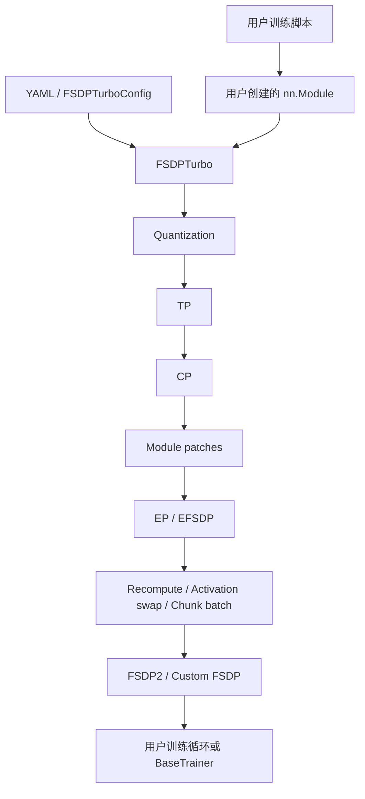
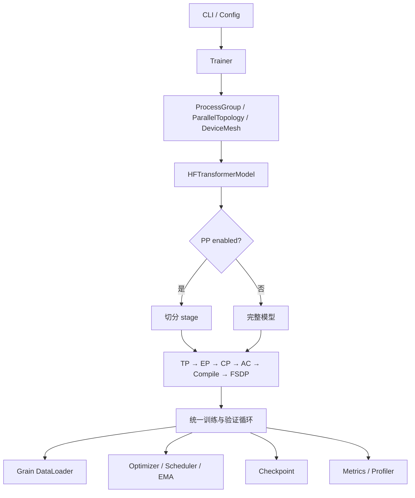

# FSDPTurbo 与 TorchLLMTuner 对比

## 1. 对比范围与口径

本文基于两个本地仓库的源码、配置入口和测试进行比较，不只引用 README：

- FSDPTurbo：`/home/jianzhnie/llmtuner/llm/FSDPTurbo`
- TorchLLMTuner：`/home/jianzhnie/llmtuner/llm/TorchLLMTuner`

| 仓库 | 版本 | 当前提交 |
|---|---:|---|
| FSDPTurbo | `0.1.0` | `1dae0be` |
| TorchLLMTuner | `0.1.0` | `eb21191` |

提交号用于定位代码来源；工作区可能还包含未提交修改。两个项目均处于早期
开发阶段，本文结论只适用于此次检查的实现。

能力标记：

| 标记 | 含义 |
|---|---|
| **集成** | 已接入核心入口或 Trainer，并有直接配置通道 |
| **可选集成** | 已接入核心流程，但需要可选依赖、特定设备或模型 |
| **底层实现** | 存在实现代码，但未由主入口完整暴露 |
| **缺口** | 没有对应实现，或配置会明确拒绝 |

“集成”只表示源码路径已接线，不代表所有模型、设备和并行组合均已完成数值
或性能验证。

## 2. 结论摘要

两者都面向 Hugging Face 模型的分布式训练，但抽象层级不同：

- **FSDPTurbo 是模型变换与训练加速库**：`FSDPTurbo(config, model)` 接收用户
  已构建的模型，注入量化、并行、重计算、activation swap、chunk batch 和
  FSDP。优势是昇腾 NPU 算子、低精度训练和显存优化。
- **TorchLLMTuner 是完整训练框架**：`Trainer(LLMTunerConfig)` 负责分布式
  初始化、HF 模型构建、五类并行、数据、训练、验证、指标、checkpoint 和
  资源释放。优势是统一生命周期、PP、组合校验和数值等价测试。

选择建议：

| 需求 | 更适合的项目 |
|---|---|
| 在既有训练脚本和模型上增量添加昇腾优化 | FSDPTurbo |
| MXFP8、W8A16、NPU 融合算子、activation/optimizer swap | FSDPTurbo |
| PP 或 FSDP/TP/PP/CP/EP 的统一编排 | TorchLLMTuner |
| 统一训练循环、validation、指标和完整状态恢复 | TorchLLMTuner |
| 研究 TorchTitan 语义和并行组合正确性 | TorchLLMTuner |
| 使用预置的 Qwen、Kimi、DeepSeek 专用适配 | FSDPTurbo |

两者可以互补：FSDPTurbo 提供设备优化执行能力，TorchLLMTuner 提供训练控制面。
实际整合前仍需定义模型、状态和错误处理边界，不能仅拼接配置或目录。

## 3. 总体定位

| 维度 | FSDPTurbo | TorchLLMTuner |
|---|---|---|
| 项目类型 | 分布式训练加速库 | 混合并行训练框架 |
| 核心抽象 | `FSDPTurbo(config, model)` 模型 wrapper | `Trainer(cfg)` 完整训练运行时 |
| 主要输入 | 用户构建的 `nn.Module` 与 YAML/dataclass 配置 | 分组 `LLMTunerConfig`，由框架构建 HF Causal LM |
| 主要输出 | 已应用并行、量化和内存变换的模型 | 完整训练任务及其模型、optimizer、数据和 checkpoint 状态 |
| 硬件方向 | 昇腾 NPU 优先，并保留 CUDA/Triton 实现 | CPU、CUDA、NPU 的统一设备抽象 |
| 模型策略 | 模块名 pattern、框架级 patch、专用 modeling | HF wrapper、TP plan、MoE 布局 probe |
| 失败策略 | 配置校验、mesh 和模块匹配检查 | 配置、mesh、组合矩阵和模型 probe 分层拒绝 |

## 4. 架构与装配顺序

### 4.1 FSDPTurbo



`fsdp_turbo/fsdp_turbo.py` 在 `FSDPTurbo.__init__` 中显式执行：

```text
Quantization → TP → CP → Module Patch → EP/EFSDP
→ Pre-FSDP Hook → Recompute → Activation Swap → Chunk Batch → FSDP
```

主要特点：

- 以模型变换为中心，不要求用户采用统一 Trainer；
- 通过模块名通配符选择转换目标；
- `module_patches` 提供框架级模块或 forward 替换；
- `parallel_state` 管理 DP、FSDP、TP、CP、EP、EDP 和 EFSDP mesh；
- `ops/` 按设备后端组织算子，量化、内存优化和专用模型是核心组成。

### 4.2 TorchLLMTuner



`llmtuner/parallel/stages.py` 唯一声明：

```text
TP → EP → CP → Activation Checkpoint → Compile（可选）→ FSDP
```

主要特点：

- Trainer 拥有从配置到资源释放的完整生命周期；
- PP 先切分模型，再对每个 model part 应用相同变换顺序；
- `parallel/compatibility.py` 集中处理需要跨层信息的组合裁决；
- HF wrapper 提供五部件视图和 forward 契约；
- 训练与 validation 共用 batch、loss、归约、指标和 checkpoint 语义。

## 5. 并行能力

| 能力 | FSDPTurbo | TorchLLMTuner |
|---|---|---|
| FSDP2 | **集成**：原生与 custom FSDP；模块 pattern、prefetch 和 CPU offload | **集成**：composable FSDP2/HSDP；reshard、混合精度、CPU offload 和 EP sparse mesh |
| DP replicate | **集成**：独立 DP 与 FSDP 轴组成 HSDP | **集成**：`data_parallel_replicate_size` 与 `data_parallel_shard_size` |
| TP | **集成**：用户配置 colwise、rowwise、sequence-parallel pattern | **集成**：由 HF TP plan 驱动，并校验模型和 MoE 布局 |
| PP | **缺口**：未发现 pipeline runtime、模型切分或 schedule | **集成**：`torch.distributed.pipelining`；已接入 1F1B 和 Interleaved1F1B |
| CP | **集成**：Ulysses、KV AllGather、KCP 可独立配置或组合 | **集成**：KV AllGather、Ulysses、KCP；支持适用的双轴 KV×Ulysses 和模型专用路径 |
| EP | **集成**：`eager`、`fused`、`mc2`、`domino`；独立 EP/EDP/EFSDP | **集成**：HF MoE 转换；默认 `alltoall`，可选 `torchao`，并有 MC2/Domino 专用实现 |
| EFSDP | **集成**：显式 `expert_fully_shard_parallel_size` | **集成**：从 sparse region 推导 `efsdp` |
| Compile | **缺口**：未见统一 `torch.compile` 装配阶段 | **集成**：全模型或逐 block compile、backend 和 async TP |
| 组合校验 | **部分集成**：分散在配置、mesh 和变换入口 | **集成**：配置、拓扑、`compatibility.py` 和模型 probe 分层执行 |

### 5.1 Mesh 表达

FSDPTurbo 的 `ParallelState` 显式包含：

```text
dp, fsdp, tp, kvallgather, kcp, ulysses, ep, edp, efsdp
```

它为 dense 参数创建 `dp_fsdp` HSDP mesh，为专家参数创建 `edp_efsdp` mesh，
并可将多个 CP 维度展平为通信组。

TorchLLMTuner 的 dense world size 为：

```text
WORLD_SIZE = dp_replicate × dp_shard × cp × tp × pp
```

其中 `cp` 是实际启用的 CP 轴乘积。EP 复用 sparse region，不额外增加设备：

```text
(dp_shard × cp × tp) % ep == 0
efsdp = (dp_shard × cp × tp) / ep
```

两者的 mesh 代数和模型约束不同，不能只复制并行度字段。

## 6. 内存优化与量化

| 能力 | FSDPTurbo | TorchLLMTuner |
|---|---|---|
| 激活重计算 | **集成**：按模块 pattern 应用 recompute | **集成**：`full`、`selective`、`memory_budget`、`region` |
| Chunk batch | **集成**：按 batch 维切分指定模块输入 | **缺口**：梯度累积和 PP microbatch 不是等价替代 |
| Chunk loss | **底层实现**：公共函数存在，主要由 Kimi 路径调用 | **集成**：Trainer 内置 chunked LM head cross entropy |
| Activation swap | **集成**：将保存的激活卸载到 host | **缺口** |
| Optimizer swap | **可选集成**：`AdamWSwap` | **缺口** |
| FSDP CPU offload | **集成**：`FSDPPlanConfig.cpu_offload` | **集成**：`fsdp_cpu_offload` 与 pin-memory 配置 |
| MXFP8 | **可选集成**：MX 格式、MXLinear、MXGMM 和 converter | **缺口** |
| W8A16 QAT | **可选集成**：Linear 与 GMM converter | **缺口** |
| 低精度 AllGather | **可选集成**：由 quantization plan 控制 | **缺口** |

FSDPTurbo 的显存和低精度工具更丰富；TorchLLMTuner 更侧重通用 AC、并行语义、
训练流程和 checkpoint 正确性。

## 7. 模型接入

### 7.1 FSDPTurbo：pattern 与受控 patch

```python
model = create_your_model()
model = FSDPTurbo(config, model)
```

- 用户创建或加载模型；
- TP、EP、FSDP 和 recompute 通过模块名 pattern 选层；
- CP 通过 function patch 接入 attention 和 loss；
- 框架级 `module_patches` 支持模型专用替换；
- 灵活、易于嵌入已有系统，但接入者需保证 pattern 和 patch 的数学语义；
- 错误 pattern 或不适用的模型结构可能到运行时才暴露。

### 7.2 TorchLLMTuner：HF wrapper 与布局探测

```python
cfg = LLMTunerConfig(...)
trainer = Trainer(cfg)
trainer.train()
```

- 通过 `AutoConfig` 和 `AutoModelForCausalLM` 构建模型；
- `HFTransformerModel` 提供五部件视图和统一 forward；
- TP 使用 HF `_tp_plan`，EP probe 检查 router、experts 和 shared expert 布局；
- 未识别或无法等价转换的布局会明确失败；
- 对高度定制、非标准 HF forward 的模型，适配成本可能高于 pattern/patch。

## 8. 配置与训练入口

| 项目 | FSDPTurbo | TorchLLMTuner |
|---|---|---|
| 根配置 | `FSDPTurboConfig` | `LLMTunerConfig` |
| 配置组织 | model、optimizer、data、run、checkpoint、distributed、memory、quantization 等 dataclass | 各领域一个 `_config.py`；根配置组合 model、parallel、optimizer、training |
| 配置文件 | 内置 YAML 加载与 dataclass 转换 | 官方 CLI 接受扁平命令行参数；复杂字段通过 Python 配置 |
| 模型变换入口 | `FSDPTurbo(config, model)` | `parallelize_hf_transformers(...)` |
| 完整训练入口 | 示例脚本或 `training.BaseTrainer` | `python -m llmtuner`、`llmtuner-train`、`Trainer(cfg)` |
| 配置校验 | 根配置按领域执行 `validate_*` | 各领域 `__post_init__`、根配置、mesh、matrix 和 probe |

FSDPTurbo 便于通过 YAML 复用完整配置。TorchLLMTuner 将约束放在对应领域，
减少模块耦合，但复杂配置的命令行表达不如结构化文件直观。

## 9. Trainer 与数据链路

| 维度 | FSDPTurbo | TorchLLMTuner |
|---|---|---|
| Trainer 定位 | `BaseTrainer` 提供基础训练能力，示例可自行组织 | `Trainer` 是稳定核心接口，装配、batch、PP 和 validation 分模块实现 |
| 模型构建 | 主要由示例或用户代码负责 | Trainer 运行时装配统一负责 |
| 数据 | 内置文本与多模态 dataloader | Grain 数据图、packing、文本/多模态和 renderer |
| 梯度累积 | 支持 | 支持，并统一 whole-batch token denominator |
| Validation | 未见等价的通用核心子系统 | 已接入 Trainer、数据、归约和指标；嵌套配置通过 Python 启用 |
| EMA | 未见通用在线 EMA | 已接入 optimizer step 和 checkpoint；嵌套配置通过 Python 启用 |
| 指标 | `TrainingMonitor` 与 profiler | 控制台、TensorBoard、W&B、profiler、memory snapshot |
| PP step | 无 | 独立 pipeline schedule 路径 |

TorchLLMTuner 对训练状态拥有更强控制，便于统一 PP、梯度累积、token loss
归一化和 validation。FSDPTurbo 更容易嵌入已有训练系统。

## 10. Checkpoint

| 能力 | FSDPTurbo | TorchLLMTuner |
|---|---|---|
| 基础后端 | PyTorch DCP | 默认 PyTorch DCP；可选 `torch_checkpointing`，由 `checkpoint.backend` 选择 |
| 训练状态 | 模型与 optimizer 等基础状态 | 模型、optimizer、scheduler、dataloader、trainer state、RNG 和已启用 EMA |
| 异步保存 | 顶层配置未暴露等价模式 | DCP 支持 `disabled`、`async`、`async_with_pinned_mem` |
| HF 初始加载 | 由用户模型加载流程负责 | 内置 HF 初始加载和 state-dict adapter，受模型布局约束 |
| HF 导出 | 未见统一导出入口 | 支持最终模型 HF 导出和 dtype 配置 |
| EP 变更恢复 | EFSDP/DCP 提供分片状态基础 | EP adapter 使用完整逻辑专家张量，支持按当前 EP 布局重新分片 |
| Seed checkpoint | 未见统一流程 | 支持单进程 step-0 seed checkpoint |

可选后端或导出路径存在，不等于所有设备和拓扑均已验证精确恢复。

## 11. 设备、算子与依赖

### FSDPTurbo

- 主要依赖：PyTorch `>=2.7`、Transformers `>=5.16`、Triton、Triton Ascend；
- 数据与模型依赖包括 FLA Core、Flash Linear Attention 等；
- NPU 可选依赖为 `torch_npu`，GPU 可选依赖为 Transformer Engine；
- `ops/` 包含 grouped matmul、permute、causal conv1d、KDA、sparse attention、
  RMSNorm、Sinkhorn 和量化等实现；
- 对昇腾训练性能和特定模型有更深的专用优化。

### TorchLLMTuner

- 主要依赖：PyTorch `>=2.12`、Transformers `>=5.11,<5.12`、
  `spmd_types==0.2.5` 和 Grain；
- 通过 `torch.accelerator` 和能力注册表抽象 CPU、CUDA、NPU；
- 主要复用 PyTorch、DTensor 和 Inductor 的算子与 collective；
- 没有与 FSDPTurbo `ops/` 等价的设备融合算子库；
- 较高的 PyTorch 下限来自 FSDP mesh 和异步 DCP API。

统一设备抽象只表示控制流可复用，不表示各设备上的所有组合具有相同验证覆盖。

## 12. 测试策略

| 项目 | 主要覆盖 |
|---|---|
| FSDPTurbo | CP、EP dispatcher、重计算、量化、NPU 算子、数据和 Trainer 单测；真实模型 system tests 与 baseline JSON；较多用例依赖 NPU |
| TorchLLMTuner | 配置、Trainer、数据、模型构件、checkpoint 和并行契约的 CPU 单测；多进程等价性脚本；能力探测与环境 skip |

两者侧重点不同：FSDPTurbo 更关注真实 NPU 模型与算子基线，TorchLLMTuner
更关注并行数学语义和组合回归。测试存在不等于对应功能已在所有环境通过。

## 13. 目录映射

| 职责 | FSDPTurbo | TorchLLMTuner |
|---|---|---|
| 根入口 | `fsdp_turbo/fsdp_turbo.py` | `llmtuner/trainer/cli.py`、`trainer/trainer.py` |
| 配置 | `fsdp_turbo/fsdp_turbo_config.py` | `llmtuner/config/` |
| 并行状态 | `distributed/parallel_state.py` | `parallel/topology.py` |
| 混合并行编排 | `FSDPTurbo.__init__` | `parallel/parallelize.py`、`stages.py` |
| 组合限制 | 配置校验和 apply 函数 | `parallel/compatibility.py`、配置和 probe |
| FSDP | `distributed/fully_shard_parallel/`、`fine_grained_fully_shard/` | `parallel/fully_shard_parallel/` |
| TP | `distributed/tensor_parallel/` | `parallel/tensor_parallel/` |
| CP | `distributed/context_parallel/` | `parallel/context_parallel/` |
| EP | `distributed/expert_parallel/` | `parallel/expert_parallel/` |
| PP | 无对应核心目录 | `parallel/pipeline_parallel/` |
| 内存优化 | `memory/` | `memory/`、`components/loss.py` |
| 量化 | `quantization/` | 无对应目录 |
| 设备算子 | `ops/` | 主要依赖 PyTorch 原语 |
| 模型适配 | `models/`、examples modeling | `models/hf/`、`models/common/`、`models/kimi/` |
| 数据 | `training/dataloader.py` | `datasets/` |
| Checkpoint | `training/checkpoint.py` | `components/checkpointer/` |
| 指标与 Profiler | `training/monitor.py`、`profiler.py` | `components/metrics.py`、`profiler.py` |

## 14. 优势与主要缺口

### 14.1 FSDPTurbo

优势：

- 昇腾 NPU 算子和模型专用优化丰富；
- 量化、低精度通信、activation/optimizer swap 较完整；
- pattern 与框架级 patch 便于接入非标准模型；
- 多种 CP 与 EP dispatcher，适合探索复杂 MoE 和长序列方案；
- 真实大模型示例与端到端基线更丰富。

主要缺口：

- 没有 PP；
- 装配顺序写在构造函数中，缺少独立 stage 表；
- 组合支持信息分散；
- pattern 灵活，但模型语义正确性更依赖接入者；
- 核心库与特定模型、设备算子的体量和依赖较大。

### 14.2 TorchLLMTuner

优势：

- FSDP、TP、PP、CP、EP 在同一运行时中编排；
- TorchTitan 训练、checkpoint、metrics 和并行语义映射清晰；
- 组合矩阵、模型 probe 和数值等价测试强调正确性；
- 配置、组件和 Trainer 职责清楚；
- 内置 validation、EMA、异步 DCP 和 HF 导入导出。

主要缺口：

- 缺少量化训练与低精度 collective；
- 缺少 activation/optimizer swap 和模块级 chunk batch；
- 缺少成熟的设备专用融合算子库；
- CLI 尚未支持 YAML/JSON，嵌套 validation/EMA 等配置需通过 Python；
- 模型适配依赖 HF wrapper 和已识别布局，对高度定制模型不如 patch 灵活。

## 15. 配置迁移参考

下表只表示概念对应，不能机械复制数值或配置字符串。

| FSDPTurbo | TorchLLMTuner | 迁移说明 |
|---|---|---|
| `distributed.data_parallel_size` | `parallel.data_parallel_replicate_size` | 结合其他轴重新核对 world size |
| `distributed.fully_shard_parallel_size` | `parallel.data_parallel_shard_size` | 概念接近；后者可设 `-1` 自动推导 |
| `distributed.tensor_parallel_size` | `parallel.tensor_parallel_size` | 度数可对应，TP plan 不能直接迁移 |
| `tp_plan.colwise_parallel` / `rowwise_parallel` | HF `_tp_plan` 与内置 TP 适配 | 从用户 pattern 转为模型 plan 和结构校验 |
| `ulysses_parallel_size` | `context_parallel_ulysses_size` | 重新检查 head 数、序列长度和 CP 组合 |
| `kv_allgather_parallel_size` | `context_parallel_kv_allgather_size` | 检查 packed、load balancer 和双轴约束 |
| `kcp_parallel_size` | `context_parallel_kcp_size`，strategy 为 `kcp` | 仅适用于已接入的 KDA 路径，不能视为通用 CP 替代 |
| `expert_parallel_size` | `expert_parallel_size` | 模型布局与 dispatcher 集合不同 |
| `expert_fully_shard_parallel_size` | 无直接字段 | 根据 sparse region 推导 `efsdp` |
| `ep_plan.dispatcher` | `ep_token_dispatcher` | 名称和实现不同，不能按字符串复制 |
| `memory.recompute` / `recompute_plan` | `activation_checkpoint_mode` 与 AC config | 从模块 pattern 迁移为 mode/policy |
| `memory.chunk_batch` | 无直接对应 | PP microbatch 和梯度累积不能等价替代 |
| `memory.swap_activation` | 无直接对应 | 需要生命周期和设备传输管理 |
| `optimizer.optimizer_type='AdamWSwap'` | 无直接对应 | 需要 optimizer 与 checkpoint 联合适配 |
| `quantization.quantization_plan` | 无直接对应 | 需要 converter、量化模块和通信路径 |
| `data.batch_size` | `training.global_batch_size` | 先确认前者是否为每 rank batch，再重新计算 |
| `data.max_seq_length` | `training.max_seq_len` | 必须满足 `cp × tp` 整除约束 |
| `run.max_steps` | `training.steps` | 训练步数概念对应 |
| `run.gradient_accumulation_steps` | `training.gradient_accumulation_steps` | 同时核对 global batch 和 token normalization |
| `checkpoint.save_steps` | `checkpoint.interval` | 保存间隔概念对应 |
| `module_patches` | 无通用对应 | 需要 HF wrapper 适配或受约束扩展点 |

### 15.1 从 FSDPTurbo 迁移

1. 确认模型能由 `AutoModelForCausalLM` 构造，并满足 HF wrapper 契约；
2. 先移除量化、swap、custom FSDP 和模型 patch，建立单进程精度基线；
3. 按目标 world size 重新设计 DP、TP、PP、CP 和 EP；
4. 先分别验证单并行族，再增加组合；
5. 重新计算 global batch、梯度累积和 PP microbatch；
6. 通过 HF 权重或双方都能解释的逻辑状态迁移，避免复制物理 shard；
7. 比较首批 step 的 loss、梯度范数和参数更新，再测试性能。

### 15.2 从 TorchLLMTuner 迁移

1. 将模型构建、训练和 validation 生命周期移至用户脚本或 `BaseTrainer`；
2. 为 TP、EP、FSDP 和 recompute 编写明确的模块 pattern；
3. 按目标 attention 路径映射 CP 轴和 dispatcher；
4. PP 没有直接落点，需要取消 PP 或引入独立 pipeline runtime；
5. 将 EP MoE 转换替换为 FSDPTurbo 支持的专家模块和 dispatcher；
6. 先验证原生精度，再逐项启用量化、swap 和融合算子；
7. 使用真实模型 baseline 验证 loss 和吞吐。

## 16. 可借鉴方向

### TorchLLMTuner 可借鉴

1. 用统一 registry 管理设备专用算子，保持模型接口稳定；
2. 增加量化 converter、MXFP8/W8A16 和低精度 AllGather；
3. 增加 activation/optimizer swap，并接入 Trainer 和 checkpoint；
4. 为 HF wrapper 无法覆盖的模型提供受约束扩展点；
5. 建立真实大模型 system test 和性能 baseline；
6. 增加结构化配置文件入口及明确的覆盖优先级。

### FSDPTurbo 可借鉴

1. 用独立 stage 表声明并测试模型变换顺序；
2. 建立集中式组合矩阵和带解锁条件的错误消息；
3. 增加 PP，并统一其与其他并行策略的装配路径；
4. 将布局 probe 与 pattern 匹配结合，检查输入输出和权重语义；
5. 扩展 checkpoint 到 dataloader、scheduler、EMA 等完整训练状态；
6. 增加小模型 CPU 契约测试和多进程数值等价测试。

## 17. 最终建议

- 目标是**昇腾性能、量化和显存极限优化**：优先 FSDPTurbo。
- 目标是**五类并行组合、TorchTitan 语义和端到端状态正确性**：优先
  TorchLLMTuner。
- 建设长期统一框架时，可将 TorchLLMTuner 的 Trainer、配置边界、PP 和组合
  矩阵作为控制面，将 FSDPTurbo 的算子、量化、swap 和设备优化作为执行能力；
  通过明确接口隔离设备专用实现，并分别验证数值、状态和性能。

## 18. 源码索引

FSDPTurbo：

- `fsdp_turbo/fsdp_turbo.py`
- `fsdp_turbo/fsdp_turbo_config.py`
- `fsdp_turbo/distributed/`
- `fsdp_turbo/memory/`
- `fsdp_turbo/quantization/`
- `fsdp_turbo/ops/`
- `fsdp_turbo/training/`

TorchLLMTuner：

- `llmtuner/trainer/cli.py`
- `llmtuner/trainer/trainer.py`
- `llmtuner/trainer/runtime/assembly.py`
- `llmtuner/config/`
- `llmtuner/parallel/`
- `llmtuner/components/`
- `llmtuner/memory/`
- `llmtuner/datasets/`
