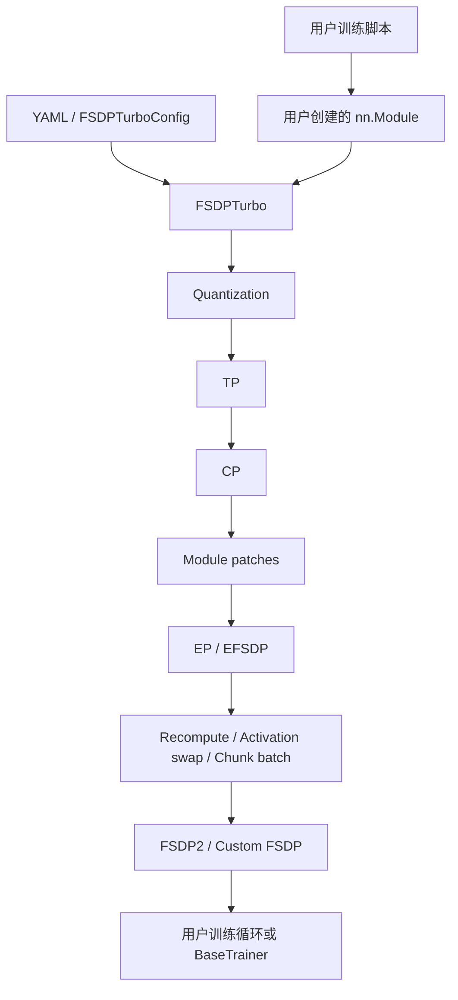
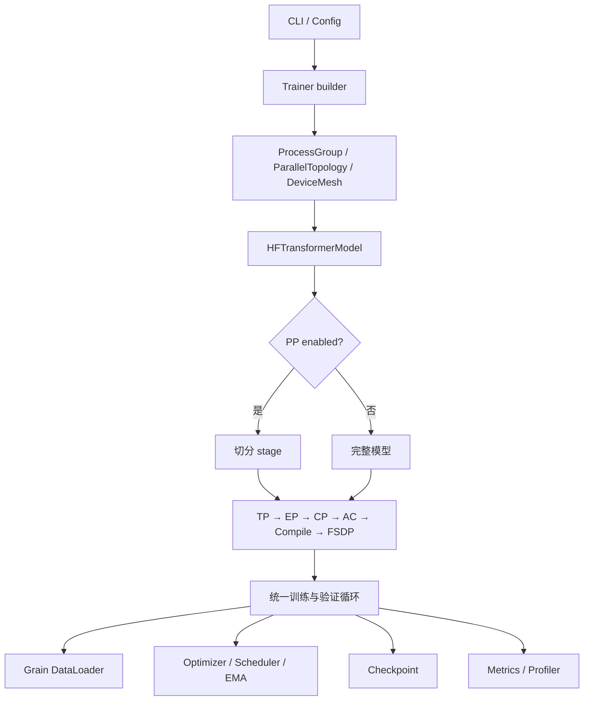

# FSDPTurbo 与 TorchLLMTuner 项目对比

## 1. 对比范围

本文基于以下两个本地仓库的当前源码进行对比：

- FSDPTurbo：`/Users/robin/work_dir/FSDPTurbo`
- TorchLLMTuner：`/Users/robin/work_dir/TorchLLMTuner`

对比基线：

| 仓库 | 版本 | 对比提交 |
|---|---:|---|
| FSDPTurbo | `0.1.0` | `8dfec48` |
| TorchLLMTuner | `0.1.0` | `9648249` |

文档重点检查代码实际提供的入口、配置、运行时和测试，不只引用 README 的功能描述。两个项目都处于早期版本，本文结论只对应上述源码快照。

### 1.1 能力成熟度定义

后文使用以下标记区分“目录中存在代码”和“用户可以稳定使用”：

| 标记 | 含义 |
|---|---|
| **集成** | 已接入核心入口或 Trainer，并有直接配置通道 |
| **可选集成** | 已接入核心流程，但需要可选依赖、特定设备或特定模型 |
| **底层实现** | 存在实现代码，但未通过默认根配置或主入口完整暴露 |
| **缺口** | 当前源码没有对应能力，或配置会明确拒绝启用 |

“支持”只表示源码路径已经接线，不表示所有模型、硬件和并行组合都已完成性能或数值验证。

## 2. 结论摘要

FSDPTurbo 和 TorchLLMTuner 都基于 PyTorch 分布式能力支持 Hugging Face 模型训练，但目标层次不同：

- **FSDPTurbo 是训练加速能力库**：核心入口 `FSDPTurbo(config, model)` 接收用户已经构建的模型，按配置注入量化、TP、CP、EP、重计算、activation swap、chunk batch 和 FSDP。它面向昇腾 NPU 深度优化，包含大量设备算子、量化模块和特定模型实现。
- **TorchLLMTuner 是完整训练框架**：核心入口 `Trainer(LLMTunerConfig)` 负责分布式初始化、模型创建、五维并行编排、数据加载、训练、验证、指标、检查点和资源释放。它强调与 TorchTitan 训练语义对齐、显式组合矩阵和可验证的模块边界。

选择建议：

| 需求 | 更适合的项目 |
|---|---|
| 在既有训练脚本和模型上增量添加昇腾优化 | FSDPTurbo |
| MXFP8、W8A16、NPU 融合算子和激活/优化器 swap | FSDPTurbo |
| 需要 PP 或 FSDP/TP/PP/CP/EP 的统一编排 | TorchLLMTuner |
| 需要统一训练循环、指标和完整状态恢复 | TorchLLMTuner |
| 研究 TorchTitan 语义和并行组合正确性 | TorchLLMTuner |
| 需要预置的 Qwen3.5、Kimi K3、DeepSeek V4.1 深度适配 | FSDPTurbo |

两者可以形成互补关系。FSDPTurbo 的底层 NPU 优化能力可以成为 TorchLLMTuner 后续设备后端的能力来源；TorchLLMTuner 的训练生命周期、PP 和组合校验也可以为 FSDPTurbo 的上层训练编排提供参考。

## 3. 总体定位对比

| 维度 | FSDPTurbo | TorchLLMTuner |
|---|---|---|
| 项目类型 | 分布式训练加速库 | 混合并行训练框架 |
| 核心抽象 | `FSDPTurbo(config, model)` 模型 wrapper | `Trainer(cfg)` 完整训练运行时 |
| 主要输入 | 用户构建的任意 `nn.Module` 与 YAML/dataclass 配置 | 分组 `LLMTunerConfig`，由框架构建 HF Causal LM |
| 主要输出 | 已应用并行和内存/量化变换的模型 | 完整训练任务及其模型、优化器、数据和 checkpoint 状态 |
| 上游设计来源 | PyTorch FSDP2、HF，并含大量昇腾专用实现 | TorchTitan 训练语义与 HF modeling backend |
| 主要硬件方向 | 昇腾 NPU 优先，并保留部分 CUDA/Triton 实现 | CPU、CUDA、NPU 的统一设备抽象 |
| 模型策略 | 通配符 plan、forward patch、专用 modeling | HF wrapper 契约、TP plan、MoE 布局 probe |
| 失败策略 | 配置校验与模块匹配检查并存 | 配置、mesh、组合矩阵和模型 probe 分层拒绝 |

## 4. 架构对比

### 4.1 FSDPTurbo



`fsdp_turbo/fsdp_turbo.py` 中的装配顺序直接写在 `FSDPTurbo.__init__`：

```text
Quantization → TP → CP → Module Patch → EP/EFSDP
→ Pre-FSDP Hook → Recompute → Activation Swap → Chunk Batch → FSDP
```

架构特点：

- 以模型变换为中心，不要求用户采用统一 Trainer；
- 通过模块名通配符选择要转换的层；
- `module_patches` 可以替换模块或 forward；
- `parallel_state` 统一管理 DP、FSDP、TP、多类 CP、EP、EDP 和 EFSDP mesh；
- `ops/` 按 NPU、CUDA、CPU 和 Triton 后端组织算子；
- 量化、内存优化和模型专用实现是核心组成部分。

### 4.2 TorchLLMTuner



装配顺序由 `llmtuner/parallel/stages.py` 作为数据统一声明：

```text
TP → EP → CP → Activation Checkpoint → Compile → FSDP
```

架构特点：

- `Trainer` 拥有从配置到训练结束的整个生命周期；
- PP 会先切分模型，再为各 stage 应用同一套变换顺序；
- `parallel/compatibility.py` 是不支持组合的统一裁决入口；
- HF wrapper 定义 embedding、layers、norm、head、attention 和 MoE 的适配契约；
- 训练与验证共享 batch、loss、归约、指标和 checkpoint 语义；
- 更强调模块职责、组合正确性和数值等价性测试。

## 5. 并行能力对比

| 能力 | FSDPTurbo | TorchLLMTuner |
|---|---|---|
| FSDP2 | **集成**：原生 FSDP2；按模块通配符选择；支持 prefetch、CPU offload，并提供 custom FSDP 路径 | **集成**：composable FSDP2/HSDP；按 decoder 层与根模块包装；支持 reshard、混合精度、CPU offload 和 EP 稀疏网格 |
| DP replicate | **集成**：独立 `data_parallel_size`，与 FSDP 组成二维 HSDP mesh | **集成**：`data_parallel_replicate_size` 与 `data_parallel_shard_size` 组成 HSDP |
| TP | **集成**：用户显式提供 colwise、rowwise、sequence parallel 模块模式 | **集成**：从 HF 模型 TP plan 推导，并对 attention、MLP、embedding、head 和已支持 MoE 进行语义校验 |
| PP | **缺口**：未发现 pipeline runtime、模型切分或 schedule | **集成**：`torch.distributed.pipelining`、stage 切分、已注册 schedule 和 microbatch |
| CP | **集成**：Ulysses、KV AllGather、KCP 可使用独立轴并组合；通过 function patch 适配 attention/loss | **集成**：`kv_allgather` 与 `ulysses` 二选一；支持 packed/varlen 和 `headtail`；由 HF attention 契约接入 |
| EP | **集成**：`eager`、`fused`、`mc2`、`domino` dispatcher；独立 EP/EDP/EFSDP；按模块 plan 注入 | **集成**：将已识别 HF MoE 转为公共 MoE 栈；默认 `alltoall`，可选 `torchao`；EP checkpoint 与负载均衡 |
| EFSDP | **集成**：显式 `expert_fully_shard_parallel_size` 和模块列表 | **集成**：从 `dp_shard × cp × tp / ep` 推导 `efsdp`，由 sparse mesh 管理 |
| Compile | **缺口**：未见统一 `torch.compile` 装配阶段 | **集成**：全模型/逐 block compile、backend 配置和 async TP 开关 |
| 组合矩阵 | **部分集成**：由 mesh 形状、配置校验和各变换执行时检查 | **集成**：`ParallelConfig`、`ParallelTopology`、`compatibility.py`、模型 probe 四层检查 |

### 5.1 世界规模表达

FSDPTurbo 将多种并行维度显式放入 `ParallelState`，包括：

```text
dp, fsdp, tp, kvallgather, kcp, ulysses, ep, edp, efsdp
```

它为 dense 参数创建 `dp_fsdp` HSDP mesh，为专家参数创建 `edp_efsdp` mesh，并把多个 CP 维度展平为 CP group。

TorchLLMTuner 的 dense 世界规模关系为：

```text
WORLD_SIZE = dp_replicate × dp_shard × cp × tp × pp
```

EP 不额外乘入世界规模，而是在 `dp_shard × cp × tp` 区域内重新分解：

```text
efsdp = (dp_shard × cp × tp) / ep
```

两者的 mesh 代数不同，配置不能直接逐字段搬运。

## 6. 内存优化与量化对比

| 能力 | FSDPTurbo | TorchLLMTuner |
|---|---|---|
| 激活重计算 | **集成**：按模块模式应用 recompute | **集成**：`full`、`selective`、`memory_budget`、`region` 四种 AC 模式 |
| Chunk batch | **集成**：按 batch 维切分指定模块输入 | **缺口**：无同名模块；梯度累积和 PP microbatch 解决的是不同层次的问题 |
| Chunk loss | **底层实现**：公共函数存在，当前主要由 Kimi 模型路径调用，未进入 `MemoryConfig` | **集成**：Trainer 内置 chunked LM head cross entropy，并校验 PP/validation 组合 |
| Activation swap | **集成**：按模块卸载保存的激活到 host | **缺口** |
| Optimizer swap | **可选集成**：`AdamWSwap` 通过 optimizer factory 选择 | **缺口** |
| FSDP CPU offload | **集成**：`FSDPPlanConfig.cpu_offload` | **集成**：`fsdp_cpu_offload` 与 `fsdp_cpu_offload_pin_memory` 已贯通 FSDP2 policy |
| MXFP8 | **可选集成**：MX 格式、MXLinear、MXGMM 和 converter | **缺口** |
| W8A16 QAT | **可选集成**：Linear 与 GMM converter | **缺口** |
| 低精度 AllGather | **可选集成**：由 quantization plan 控制 | **缺口** |

FSDPTurbo 在显存优化和低精度训练方面明显更完整。TorchLLMTuner 当前将重点放在并行语义、训练流程和 checkpoint 正确性上。

## 7. 模型接入方式

### 7.1 FSDPTurbo：通配符 plan 与 patch

典型使用方式：

```python
model = create_your_model()
model = FSDPTurbo(config, model)
```

接入特征：

- 用户负责创建或加载模型；
- TP、EP、FSDP、重计算等通过模块名 pattern 选层；
- CP 通过 function patch 包装模型 attention 和 loss；
- `module_patches` 支持模型专用 forward 替换；
- 仓库包含 Qwen、Kimi 和 DeepSeek V4.1 的专用模块与示例 modeling；
- 灵活性高，但 plan 的正确性由接入者负责，错误 pattern 需要在运行时发现。

### 7.2 TorchLLMTuner：HF wrapper 契约与布局探测

典型使用方式：

```python
cfg = LLMTunerConfig(...)
trainer = Trainer(cfg)
trainer.train()
```

接入特征：

- 框架通过 `AutoConfig` 和 `AutoModelForCausalLM` 构建模型；
- `HFTransformerModel` 提供稳定的五部件视图和 forward 契约；
- TP 使用 HF `_tp_plan` 并补充模型结构检查；
- EP probe 识别 router、experts、shared expert 和权重布局；
- 未识别布局会明确失败，降低“运行成功但数学错误”的风险；
- 对高度定制、非标准 HF forward 的模型，适配成本可能高于 pattern/patch 方案。

## 8. 配置与入口对比

| 项目 | FSDPTurbo | TorchLLMTuner |
|---|---|---|
| 根配置 | `FSDPTurboConfig` | `LLMTunerConfig` |
| 配置组织 | 一个文件内包含 model、optimizer、data、run、checkpoint、distributed、memory、quantization 等 dataclass | 每个领域一个 `_config.py`，根配置组合 model、parallel、optimizer、training |
| 配置文件 | 内置 YAML 加载与 dataclass 转换 | 当前官方 CLI 入口仅接受扁平命令行参数 |
| 模型变换入口 | `FSDPTurbo(config, model)` | `parallelize_hf_transformers(...)` |
| 完整训练入口 | 示例脚本或 `training.BaseTrainer` | `python -m llmtuner`、`llmtuner-train`、`Trainer(cfg)` |
| 配置校验 | 根配置中按领域执行 `validate_*` | 各领域 `__post_init__` + 根配置 + mesh + matrix + probe |

FSDPTurbo 的单文件配置便于 YAML 映射和示例复制。TorchLLMTuner 的分域配置减少模块耦合，更便于将每类约束放在对应领域，但当前 CLI 尚未提供 YAML/JSON 文件入口。

## 9. Trainer 与数据链路

| 维度 | FSDPTurbo | TorchLLMTuner |
|---|---|---|
| Trainer 定位 | `BaseTrainer` 提供初始化、优化器、调度器、训练和保存的基础能力；示例可自行组织 | `Trainer` 是稳定核心接口，builder、batch、pipeline step、validation 各自拆分 |
| 模型构建 | 主要由示例/用户代码负责 | Trainer builder 统一负责 |
| 数据 | 内置文本与多模态 dataloader，示例使用 dataset 配置 | Grain 数据图、packing、random/text/multimodal、renderer |
| 梯度累积 | 支持 | 支持，并统一 whole-batch token denominator |
| 验证循环 | 未见与核心 Trainer 等价的通用 validation 子系统 | 已接入 Trainer、数据加载、归约和指标；`ValidationConfig` 当前仅支持程序化配置 |
| EMA | 未见通用在线 EMA | 已接入优化器步骤与 checkpoint；`EMAConfig` 当前仅支持程序化配置 |
| 指标 | `TrainingMonitor` 与 profiler | 控制台、TensorBoard、W&B、Profiler、memory snapshot |
| PP step | 无 | 独立 pipeline schedule 路径 |

TorchLLMTuner 对一次训练任务的状态和步骤拥有更强控制，因此更容易保证 PP、梯度累积、token loss 归一化和验证之间的一致性。FSDPTurbo 更容易嵌入已有训练系统。

## 10. Checkpoint 对比

| 能力 | FSDPTurbo | TorchLLMTuner |
|---|---|---|
| 基础后端 | PyTorch DCP | **集成**：PyTorch DCP；**底层实现**：`torch_checkpointing` manager 已移植，但当前根配置和 Trainer 没有 backend 选择项 |
| 模型与优化器 | 支持保存与恢复 | 支持模型、优化器、scheduler、dataloader、trainer state、EMA |
| 异步保存 | 未在顶层配置中暴露等价模式 | `disabled`、`async`、`async_with_pinned_mem` |
| HF 初始加载 | 用户模型加载流程负责 | 内置 HF 初始加载和 state dict adapter |
| HF 导出 | 未见统一导出入口 | DCP 路径支持最终模型 HF 导出和 dtype 配置 |
| EP 变更恢复 | EFSDP/DCP 提供分片状态保存基础 | EP checkpoint adapter 将专家还原成全量逻辑张量，可跨 EP 度数恢复 |
| Seed checkpoint | 未见统一流程 | 支持单进程 step 0 seed checkpoint |

## 11. 设备、算子与依赖

### FSDPTurbo

- 主要依赖：PyTorch `>=2.7`、Transformers `>=5.2`、Triton、Triton Ascend；
- NPU 可选依赖：`torch_npu`、`fla-core`、`flash-linear-attention`；
- GPU 可选依赖：Transformer Engine；
- `ops/` 包含 grouped matmul、permute、causal conv1d、KDA、sparse attention、RMSNorm、Sinkhorn、量化等实现；
- 包含 NPU、CUDA、CPU 和 Triton 后端注册机制；
- 对昇腾训练性能和特定前沿模型有更深的专用优化。

### TorchLLMTuner

- 主要依赖：PyTorch `>=2.12`、Transformers `>=5.9,<5.10`、`spmd_types`、Grain；
- 通过 `torch.accelerator` 和能力注册表抽象 CPU、CUDA、NPU；这里表示控制流具备统一适配层，不表示每种设备上的所有并行组合都已经过同等规模验证；
- 主要复用 PyTorch/DTensor/Inductor 的算子和 collective；
- 当前没有与 FSDPTurbo `ops/` 等价的设备融合算子库；
- 更高 PyTorch 版本下限来自 FSDP mesh 和异步 DCP API。

## 12. 测试策略对比

### FSDPTurbo

- 单元测试覆盖 CP、EP dispatcher、重计算、量化、NPU 算子、数据和 Trainer；
- system tests 覆盖 Qwen3、Qwen3.5、Qwen3.5 MoE、DeepSeek V4、Kimi K3；
- system tests 使用 baseline JSON 比较端到端结果；
- 大量测试依赖 NPU 软件栈和相应硬件。

### TorchLLMTuner

- CPU pytest 覆盖配置、Trainer、数据、模型公共组件、checkpoint 和各并行模块契约；
- `tests/integration_tests/` 提供 TP、FSDP、CP、PP、EP 及组合的多进程等价性脚本；
- 强调分片结果与单进程参考结果的数值等价；
- 能力探测对依赖或硬件不足的测试进行环境门控。

测试侧重点也反映了项目定位：FSDPTurbo 更关注真实 NPU 模型与算子基线，TorchLLMTuner 更关注并行数学语义和组合回归。

## 13. 目录映射

| 职责 | FSDPTurbo | TorchLLMTuner |
|---|---|---|
| 根入口 | `fsdp_turbo/fsdp_turbo.py` | `llmtuner/trainer/cli.py`、`trainer/trainer.py` |
| 配置 | `fsdp_turbo/fsdp_turbo_config.py` | `llmtuner/config/` |
| 并行状态 | `distributed/parallel_state.py` | `parallel/topology.py` |
| 混合并行编排 | `FSDPTurbo.__init__` | `parallel/parallelize.py`、`parallel/stages.py` |
| 组合限制 | 各配置校验和 apply 函数 | `parallel/compatibility.py` 与各配置/probe |
| FSDP | `distributed/fully_shard_parallel/`、`fine_grained_fully_shard/` | `parallel/fully_shard_parallel/` |
| TP | `distributed/tensor_parallel/` | `parallel/tensor_parallel/` |
| CP | `distributed/context_parallel/` | `parallel/context_parallel/` |
| EP | `distributed/expert_parallel/` | `parallel/expert_parallel/` |
| PP | 无对应核心目录 | `parallel/pipeline_parallel/` |
| 内存优化 | `memory/` | `memory/activation_checkpoint.py`、`components/loss.py` |
| 量化 | `quantization/` | 当前无对应目录 |
| 设备算子 | `ops/` | 主要依赖 PyTorch 原语 |
| 模型适配 | `models/`、examples 中的 modeling | `models/hf/`、`models/common/` |
| 数据 | `training/dataloader.py` | `datasets/` |
| Checkpoint | `training/checkpoint.py` | `components/checkpointer/` |
| 指标与 Profiler | `training/monitor.py`、`profiler.py` | `components/metrics.py`、`profiler.py` |

## 14. 各自优势与主要缺口

### 14.1 FSDPTurbo

优势：

- 昇腾 NPU 能力深，包含丰富的融合算子与模型专用优化；
- 量化、低精度通信、activation swap、optimizer swap 能力完整；
- pattern 与 patch 机制便于接入非标准模型；
- 多种 CP 与 EP dispatcher，适合探索复杂 MoE 和长序列方案；
- 真实大模型示例和端到端基线更丰富。

主要缺口：

- 当前没有 PP；
- 混合并行装配顺序写在构造函数中，缺少独立 stage 表；
- 组合支持信息分散在配置和各模块内部；
- 通配符 plan 灵活，但对模型语义正确性的静态保障较弱；
- 核心库与特定模型、设备算子之间的体量和依赖较大。

### 14.2 TorchLLMTuner

优势：

- FSDP、TP、PP、CP、EP 在同一训练运行时中编排；
- 与 TorchTitan 的训练、checkpoint、metrics 和并行语义映射清晰；
- 组合矩阵、模型 probe 和数值等价测试强调正确性；
- 配置、组件和 Trainer 职责较清楚；
- 内置验证、EMA、异步 DCP checkpoint 和 HF 导入导出；验证与 EMA 当前通过程序化配置启用。

主要缺口：

- 当前缺少量化训练与低精度 collective；
- 缺少 activation/optimizer swap 和 FSDPTurbo 的 chunk batch；
- 缺少成熟的设备专用融合算子库；
- CLI 尚未支持 YAML/JSON 配置文件；
- `ValidationConfig`、`EMAConfig` 和可选 `torch_checkpointing` backend 尚未接入扁平 CLI；
- 模型适配依赖 HF wrapper 和已识别布局，对高度定制模型的覆盖不如 patch 方案灵活。

## 15. 配置迁移参考

两套配置的 mesh 定义、batch 语义和模型接入方式不同。下表只给出概念对应关系，不能机械地复制数值。

| FSDPTurbo | TorchLLMTuner | 迁移说明 |
|---|---|---|
| `distributed.data_parallel_size` | `parallel.data_parallel_replicate_size` | 都表示 HSDP 的 replicate 轴，但需结合其他轴重新核对 `WORLD_SIZE` |
| `distributed.fully_shard_parallel_size` | `parallel.data_parallel_shard_size` | 概念最接近；TorchLLMTuner 可设为 `-1` 自动推导 |
| `distributed.tensor_parallel_size` | `parallel.tensor_parallel_size` | 并行度可对应；TP plan 不能直接迁移 |
| `tp_plan.colwise_parallel` / `rowwise_parallel` | HF `_tp_plan` 与内置 TP 适配 | FSDPTurbo 使用用户 pattern，TorchLLMTuner 从模型 plan 与结构推导 |
| `ulysses_parallel_size` | `context_parallel_size` + `context_parallel_strategy='ulysses'` | TorchLLMTuner 只有一个 CP 轴 |
| `kv_allgather_parallel_size` | `context_parallel_size` + `context_parallel_strategy='kv_allgather'` | 需要重新检查 head 数和序列长度整除关系 |
| `kcp_parallel_size` | 无直接对应 | 需要新增 CP strategy 和相应 attention kernel |
| `expert_parallel_size` | `expert_parallel_size` | 并行度概念对应，但支持的模型布局与 dispatcher 不同 |
| `expert_fully_shard_parallel_size` | 无直接字段 | TorchLLMTuner 根据 dense sparse-region 关系推导 `efsdp` |
| `ep_plan.dispatcher` | `ep_token_dispatcher` | dispatcher 名称和实现集合不同，不能按字符串直接复制 |
| `memory.recompute` / `recompute_plan` | `activation_checkpoint_mode` 与相应 AC config | 从模块 pattern 迁移为 mode/policy |
| `memory.chunk_batch` | 无直接对应 | PP microbatch 和梯度累积不能等价替代模块级 chunk batch |
| `memory.swap_activation` | 无直接对应 | 需要新增生命周期与设备传输管理 |
| `optimizer.optimizer_type='AdamWSwap'` | 无直接对应 | TorchLLMTuner 当前仅有常规 AdamW 实现族 |
| `quantization.quantization_plan` | 无直接对应 | 需要先移植 converter、量化 tensor/module 和通信路径 |
| `data.batch_size` | `training.global_batch_size` | 前者需结合示例确认每 rank 语义；后者是全局 batch，迁移时必须重新计算 |
| `data.max_seq_length` | `training.max_seq_len` | 数值可对应，但 TorchLLMTuner 要求被 `cp × tp` 整除 |
| `run.max_steps` | `training.steps` | 训练步数概念对应 |
| `run.gradient_accumulation_steps` | `training.gradient_accumulation_steps` | 需同时确认 global batch 和 token normalization |
| `checkpoint.save_steps` | `checkpoint.interval` | 保存间隔概念对应 |
| `module_patches` | 无通用对应 | 需要实现 HF wrapper 适配或增加受约束扩展点 |

### 15.1 从 FSDPTurbo 迁移到 TorchLLMTuner

1. 先确认模型能由 `AutoModelForCausalLM` 构造，并满足 `HFTransformerModel` 的五部件契约；
2. 去除量化、KCP、swap、custom FSDP 和模型 patch，先建立单进程 FP32/BF16 loss 基线；
3. 按 TorchLLMTuner 的世界规模公式重新设计 DP、TP、PP、CP 和 EP；
4. 单独启用一个并行维度并运行等价性检查，再逐步增加组合；
5. 重新计算 global batch、梯度累积和 PP microbatch；
6. 将 checkpoint 转成 HF 权重或其他双方都能解释的逻辑状态，避免复制物理 shard；
7. 对首批若干 step 比较 loss、梯度范数和参数更新，再开展性能测试。

### 15.2 从 TorchLLMTuner 迁移到 FSDPTurbo

1. 将模型构建、训练循环和验证生命周期移回用户脚本或 `BaseTrainer` 子类；
2. 为 TP、EP、FSDP 和 recompute 明确编写模块 pattern；
3. 将单一 CP strategy 映射到 Ulysses 或 KV AllGather 轴；
4. PP 没有直接落点，需要取消 PP 或在外层引入独立 pipeline runtime；
5. 将 TorchLLMTuner 的 EP MoE 转换逻辑替换为 FSDPTurbo 支持的专家模块与 dispatcher；
6. 先使用原生精度验证，再逐项打开 MXFP8、W8A16、swap 和融合算子；
7. 使用 system-test baseline 验证真实模型 loss 和吞吐。

## 16. 可借鉴的优化方向

### TorchLLMTuner 可从 FSDPTurbo 借鉴

1. 将 NPU/GPU 专用算子放入统一 registry，保持上层模型接口稳定；
2. 增加量化配置、模型 converter、MXFP8/W8A16 和低精度 AllGather；
3. 增加 activation swap 与 optimizer swap，并接入 Trainer 生命周期和 checkpoint；
4. 引入受约束的模块 pattern/patch 扩展点，用于 HF wrapper 无法覆盖的模型；
5. 建立真实大模型 system test 与性能 baseline；
6. 为用户配置增加 YAML 文件入口和清晰的覆盖优先级。

### FSDPTurbo 可从 TorchLLMTuner 借鉴

1. 用独立 stage 表声明并测试模型变换顺序；
2. 建立集中式并行组合矩阵和带解锁条件的错误消息；
3. 增加 PP，并统一 PP 与其他并行策略的装配路径；
4. 将模型布局 probe 与 pattern 匹配结合，验证被选模块的输入输出和权重语义；
5. 扩展 checkpoint 到 dataloader、scheduler、EMA 等完整训练状态；
6. 增加小模型 CPU 契约测试和多进程数值等价测试，减少对专用硬件的基础验证依赖。

## 17. 最终建议

- 如果目标是**昇腾大模型性能、量化和显存极限优化**，优先使用 FSDPTurbo，并基于其预置模型示例适配。
- 如果目标是**统一研究五维并行组合、TorchTitan 训练语义和端到端状态正确性**，优先使用 TorchLLMTuner。
- 如果要建设一个长期统一框架，建议以 TorchLLMTuner 的 Trainer、配置边界、PP 和组合矩阵作为控制面，以 FSDPTurbo 的算子、量化、swap 和设备优化作为执行后端，并通过明确接口隔离设备专用实现。

## 18. 源码索引

FSDPTurbo：

- `fsdp_turbo/fsdp_turbo.py`
- `fsdp_turbo/fsdp_turbo_config.py`
- `fsdp_turbo/distributed/parallel_state.py`
- `fsdp_turbo/distributed/`
- `fsdp_turbo/memory/`
- `fsdp_turbo/quantization/`
- `fsdp_turbo/ops/`
- `fsdp_turbo/training/`

TorchLLMTuner：

- `llmtuner/trainer/cli.py`
- `llmtuner/trainer/trainer.py`
- `llmtuner/trainer/runtime/assembly.py`
- `llmtuner/config/`
- `llmtuner/parallel/parallelize.py`
- `llmtuner/parallel/stages.py`
- `llmtuner/parallel/compatibility.py`
- `llmtuner/parallel/topology.py`
- `llmtuner/components/`
- `llmtuner/memory/`
- `llmtuner/datasets/`
