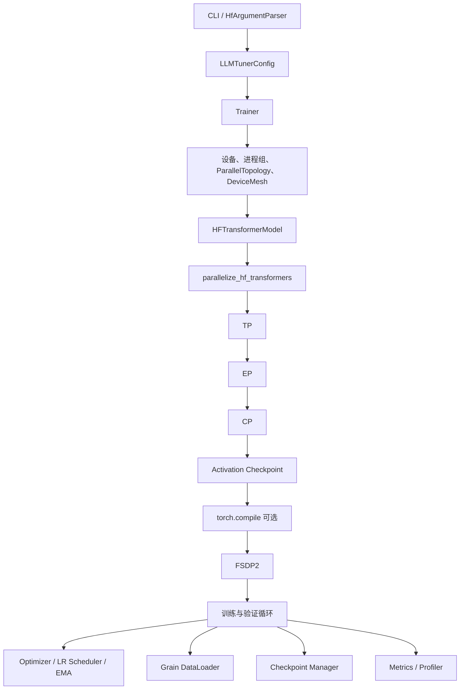

# TorchLLMTuner 简介

## 1. 项目定位

TorchLLMTuner 是基于 PyTorch `DeviceMesh` 的大模型混合并行训练框架，Python
包名为 `llmtuner`。项目直接适配 Hugging Face Transformers 模型，将 FSDP2、
张量并行（TP）、流水线并行（PP）、上下文并行（CP）和专家并行（EP）组织在
一套显式、可校验的训练流程中。

实现语义以 TorchTitan 为参考，并针对 HF 模型结构和状态字典提供适配层。
并行变换集中在 `llmtuner/parallel/`，训练生命周期由 `llmtuner/trainer/`
编排。无法保证数学语义或运行安全的组合会在配置或装配阶段明确报错，避免
静默降级。

适用于：

- 使用 Hugging Face Causal LM 开展单机或多机训练；
- 研究和验证 FSDP2、TP、PP、CP、EP 及其组合；
- 跟踪模型构建、并行化、训练、验证和 checkpoint 的完整执行路径；
- 在 CUDA 或昇腾 NPU 上复用统一的设备与分布式接口，并使用 CPU 完成
  单进程运行和适用的逻辑测试。

> 仓库名为 `TorchLLMTuner`；安装后的 Python 包名和命令名分别为
> `llmtuner` 与 `llmtuner-train`。

## 2. 核心能力

### 2.1 混合并行

| 并行方式 | 实现概述 |
|---|---|
| FSDP2 / HSDP | 使用 composable `fully_shard`；支持 DP shard、DP replicate、混合精度、reshard 和 CPU offload；EP 下区分 dense 与 sparse mesh。 |
| TP | 由 HF TP plan 驱动，使用序列并行语义的通信线性层；支持适用的 dense 与 MoE 布局。 |
| PP | 使用 `torch.distributed.pipelining` 切分 stage 并构建 schedule；已接入 1F1B 和 Interleaved1F1B。 |
| CP | 支持 `kv_allgather` 与 `ulysses`；支持适用的 packed/varlen 输入和可选 `headtail` 负载均衡。 |
| EP | 将可识别的 HF MoE block 转换为原生 MoE 实现；支持 AllToAll、可选 TorchAO dispatcher、专家状态字典和负载均衡。 |

dense world size 满足：

```text
WORLD_SIZE = dp_replicate × dp_shard × cp × tp × pp
```

EP 复用 `dp_shard × cp × tp` 稀疏区域，不额外乘入 world size：

```text
(dp_shard × cp × tp) % ep == 0
efsdp = (dp_shard × cp × tp) / ep
```

`data_parallel_shard_size=-1` 时，框架根据 world size 和其他并行度推导
`dp_shard`。实际拓扑仍以运行时 mesh 和 rank 分组为准。

### 2.2 训练与内存管理

- activation checkpointing：`full`、`selective`、`memory_budget` 和 `region`；
- chunked loss 与 vocab-parallel loss；
- 梯度累积、梯度裁剪、学习率调度和参数组；
- 在线 EMA、训练中 validation、确定性模式和异常检测；
- DCP 与可选 `torch_checkpointing` 后端；
- 模型、optimizer、scheduler、dataloader 和训练状态恢复；
- TensorBoard、Weights & Biases、profiler 和显存快照。

各项能力有各自的模型、拓扑和环境约束；列出功能不等于所有组合均已通过验收。

### 2.3 模型与数据

- 通过 `AutoConfig` / `AutoModelForCausalLM` 接入 HF 模型；
- 自动补全模型架构参数，或通过 `arch_overrides` 覆盖离线构造的字段；
- 适配 HF 状态字典与并行后的模型状态；
- 使用 Grain 构建数据流水线；
- 支持随机数据、JSONL、Hugging Face dataset 和文本 packing；
- 提供多模态处理、packing 与 batch 构建；
- 支持 chat template 和可选多轮 renderer。

当前 `HFTransformerModel` 是文本 decoder 适配器，不消费图片、视频或 MRoPE
输入，遇到这些字段会明确报错。完整视觉训练仍需要消费媒体和位置元数据的
模型适配器，不能以多模态数据管线可用代替模型训练可用。

TP 或 EP 是否可用于某个模型，取决于模块布局、TP plan 和专家结构。
未知或无法等价转换的布局会被拒绝。

## 3. 总体架构



装配顺序由 `llmtuner/parallel/stages.py` 唯一声明：

```text
TP → EP → CP → Activation Checkpoint → Compile（可选）→ FSDP
```

FSDP 最后应用，使其包装位于其他模型变换之外。启用 PP 时，框架先生成当前
rank 的 pipeline stage，再对每个 model part 应用相同顺序，最后构建 schedule。

## 4. 训练流程

命令行入口为 `llmtuner/trainer/cli.py`，训练编排位于
`llmtuner/trainer/trainer.py`：

1. 解析配置组并聚合为 `LLMTunerConfig`；
2. 初始化设备、进程组和随机性；
3. 校验并行度并构建 `ParallelTopology` 与 mesh views；
4. 创建 `HFTransformerModel`，按需在 meta device 上初始化；
5. 按 stage 表执行并行变换；
6. 创建 optimizer、scheduler、EMA、dataloader、checkpoint 和指标组件；
7. 准备 batch，执行前向与反向，归一化 loss，裁剪梯度并更新参数；
8. 按配置运行 validation、周期保存和最终保存；
9. 关闭训练资源，并由命令行入口销毁进程组。

PP 由 schedule 驱动 microbatch；非 PP 直接调用模型前向。两条路径共用 batch
语义、loss 归一化、优化器步骤、指标和 checkpoint 状态。

## 5. 配置体系

配置按职责拆分在 `llmtuner/config/`，模块使用 `_config.py` 后缀。

| 配置 | 主要职责 |
|---|---|
| `ModelConfig` | 模型来源、离线模型形状、计算 dtype、架构覆盖项 |
| `ParallelConfig` | DP/FSDP、TP、PP、CP、EP 及 dispatcher、schedule |
| `OptimizerConfig` | AdamW、参数组、学习率和权重衰减 |
| `LRSchedulerConfig` | warmup、衰减、总步数与最小学习率比例 |
| `TrainingConfig` | batch、序列长度、步数、梯度累积、AC 和 compile |
| `DataloaderConfig` | 数据源、tokenizer、packing、文本与多模态字段 |
| `CheckpointConfig` | 保存、恢复、异步模式及 HF 导入导出 |
| `MetricsConfig` / `ProfilerConfig` | 日志、TensorBoard、W&B、profiling 和显存快照 |
| `ValidationConfig` | 验证频率、步数与数据集 |
| `LLMTunerConfig` | 聚合配置并执行跨组校验 |

CLI 使用扁平参数，标量配置字段映射为 `--字段名`。查看完整参数：

```bash
python -m llmtuner --help
# 或安装后
llmtuner-train --help
```

## 6. 安装

环境要求：

- Python 3.10 或更高版本；
- PyTorch 2.12 或更高版本；
- Transformers 5.11.x；
- 其余依赖及精确版本约束见 `pyproject.toml`。

```bash
git clone https://github.com/jianzhnie/TorchLLMTuner.git
cd TorchLLMTuner
pip install -e .
```

开发环境：

```bash
pip install -e '.[dev]'
pre-commit install
```

## 7. 快速开始

### 7.1 单进程训练

默认使用随机 token 数据和小型离线模型，无需下载权重：

```bash
python -m llmtuner --steps 20
# 或安装后
llmtuner-train --steps 20
```

### 7.2 两卡 FSDP2

```bash
torchrun --nproc_per_node=2 -m llmtuner \
  --data_parallel_shard_size 2 \
  --global_batch_size 8 \
  --steps 20
```

也可使用 `--data_parallel_shard_size -1`，自动分配其他并行维度之外的 rank。

### 7.3 TP 与混合并行

两卡 TP：

```bash
torchrun --nproc_per_node=2 -m llmtuner \
  --tensor_parallel_size 2 \
  --max_seq_len 128 \
  --steps 20
```

八卡 FSDP × TP × PP：

```bash
torchrun --nproc_per_node=8 -m llmtuner \
  --data_parallel_shard_size 2 \
  --tensor_parallel_size 2 \
  --pipeline_parallel_size 2 \
  --num_pp_microbatches 2 \
  --global_batch_size 8 \
  --max_seq_len 128
```

这里 `dp_shard × tp × pp = 2 × 2 × 2 = 8`。启用 CP 时，`max_seq_len`
必须能被 `cp × tp` 整除。

### 7.4 Checkpoint

```bash
python -m llmtuner \
  --steps 20 \
  --enable \
  --interval 10 \
  --dump_folder ./outputs
```

`--enable` 是 `CheckpointConfig.enable` 的扁平 CLI 形式。加载路径、异步保存
和 HF 导出选项可通过 `--help` 查询。最终 model-only 或 HF 导出物不包含完整
训练状态，不能用于精确续训。

### 7.5 真实数据

```bash
python -m llmtuner \
  --dataset local_jsonl \
  --dataset_path ./corpus.jsonl \
  --tokenizer_path ./tokenizer \
  --steps 20
```

默认字段和 packing 策略由 `DataloaderConfig` 定义。使用真实模型或 tokenizer
时，需要保证本地文件或 Hugging Face Hub 访问可用。

### 7.6 示例脚本

从仓库根目录以模块方式运行：

```bash
python -m examples.train_qwen3
python -m examples.train_deepseek_v3
```

昇腾 NPU 多卡示例见 `examples/train_qwen3_8b_npu.sh`。
设置 `LLMTUNER_ENABLE_TENSORBOARD=1` 可保存逐步指标（需安装 TensorBoard），
包括端到端 step 耗时；事件写入运行输出目录的 `tb/`。

## 8. 组合校验与已知边界

框架通过三层校验降低运行中失败的概率：

1. 配置类的 `__post_init__` 校验字段和仅依赖配置的组合；
2. `LLMTunerConfig` 与 `ParallelTopology` 校验跨组约束和 mesh 代数；
3. `parallel/compatibility.py` 与模型布局 probe 校验运行时组合和模型结构。

常见边界：

- TP>1 只能使用序列并行路径；`enable_sequence_parallel=False` 不受支持；
- `max_seq_len` 必须能被 `cp × tp` 整除；
- chunked loss 不能与 PP 或 validation 同时启用；
- PP 不支持跨首尾 stage 的 tied word embedding；
- 一维 packed token 流不能在 PP 中切分为多个 microbatch；
- EP 的 HF 初始加载依赖模型专用 sharded adapter；Qwen3MoE、Kimi Linear
  和其他布局的支持条件不同，未适配布局会被拒绝；
- `deepep` 与 `hybridep` 是已登记的能力缺口，默认 dispatcher 为 `alltoall`；
- CP 的 `ptrr` 尚未实现，`ulysses` 不与 load balancer 组合；
- `memory_budget` AC 需要 compile，`region` AC 需要可选 `torch_remat`；
- 特定路由器、共享专家或带 bias 的专家布局可能被模型 probe 拒绝。

这里只列出常见限制，完整裁决以配置校验、`parallel/compatibility.py`
和实际错误信息为准。

## 9. 代码结构

```text
llmtuner/
├── accelerator/               # 设备、进程组、collective、SPMD 上下文
├── components/                # loss、optimizer/EMA、checkpoint、metrics、profiler
├── config/                    # 分组配置、CLI 视图和聚合配置
├── datasets/                  # Grain 数据图、packing、文本与多模态处理
├── memory/                    # activation checkpoint 与 rematerialization
├── models/
│   ├── hf/                    # HF wrapper、模型工厂和状态字典适配
│   ├── common/                # attention、MoE、embedding、RoPE 等公共构件
│   └── kimi/                  # Kimi Linear 专用模型与布局适配
├── parallel/
│   ├── tensor_parallel/       # TP 入口与通信线性层
│   ├── expert_parallel/       # EP 模型转换、dispatch 和 checkpoint 适配
│   ├── context_parallel/      # CP 输入分片与 attention kernel
│   ├── pipeline_parallel/     # PP 模型切分和 schedule
│   ├── fully_shard_parallel/  # FSDP2/HSDP 入口与参数处理
│   ├── topology.py            # 并行维度与 DeviceMesh
│   ├── stages.py              # 并行装配顺序
│   ├── compatibility.py       # 跨层组合裁决
│   └── parallelize.py         # 混合并行总入口
├── trainer/                   # 装配、训练、validation 和运行时辅助逻辑
└── utils/                     # 日志、随机性、GC 和监控等工具
```

各并行族由同名模块提供公共入口，例如
`parallel/tensor_parallel/tensor_parallel.py`。包级 `__init__.py` 只暴露有意
公开的 API；实现代码从定义符号的叶子模块导入，避免不必要的引擎依赖。

## 10. 测试与开发

```bash
pytest -q --disable-warnings
ruff check llmtuner tests
ruff format --check llmtuner tests
pre-commit run --all-files
```

`tests/integration_tests/` 包含需要 `torchrun` 和相应设备的数值等价性脚本，
不由默认 pytest 收集。运行前应核对脚本 docstring 中的命令、rank 数和参数。
CPU 或 mock 测试通过不能外推为目标设备或其他并行组合通过。

更多内容：

- 架构与运行时契约：`docs/torchllmtuner_design.md`
- TorchTitan 来源与符号映射：`docs/llmtuner_upstream_map.md`
