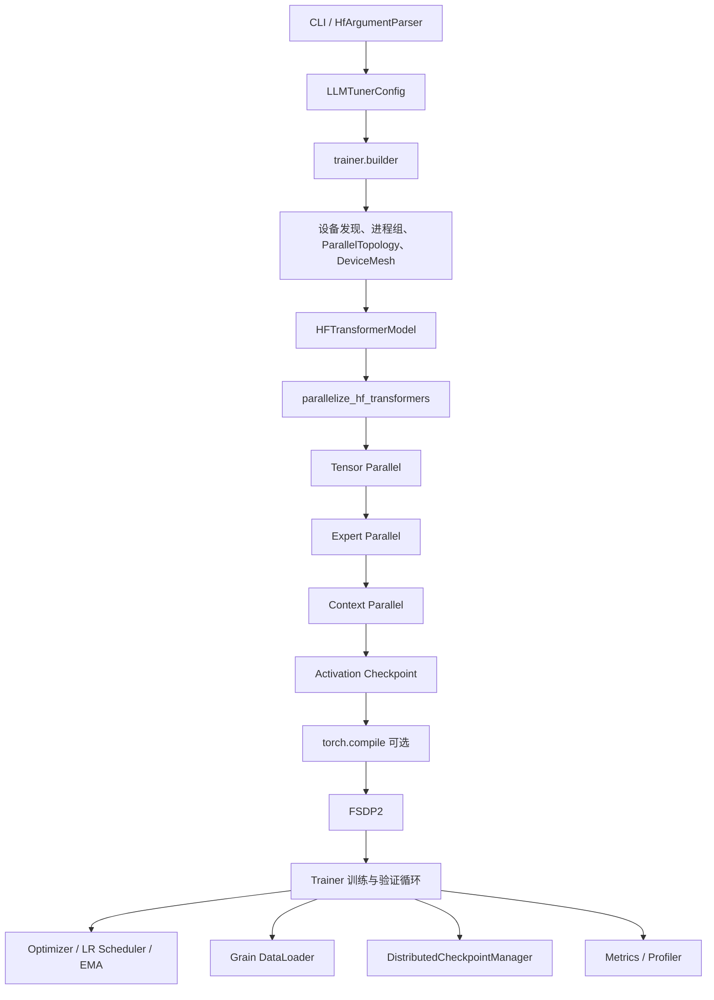

# TorchLLMTuner 简介

## 1. 项目定位

TorchLLMTuner 是一个基于 PyTorch `DeviceMesh` 的大模型混合并行训练框架，Python 包名为 `llmtuner`。项目直接适配 Hugging Face Transformers 模型，并将 FSDP2、张量并行（TP）、流水线并行（PP）、上下文并行（CP）和专家并行（EP）组织在一套显式、可校验的训练流程中。

项目的实现语义与 TorchTitan 对齐，并针对 Hugging Face 模型的结构和状态字典增加适配层。并行变换集中在 `llmtuner/parallel/`，训练生命周期由 `llmtuner/trainer/` 统一编排。无法保证数学语义或运行安全的组合会在配置或装配阶段抛出明确异常，避免静默降级。

TorchLLMTuner 适合以下场景：

- 使用 Hugging Face Causal LM 开展单机或多机训练；
- 研究和验证 FSDP2、TP、PP、CP、EP 及其组合；
- 需要清晰了解模型构建、并行化、训练、验证和检查点的完整执行路径；
- 在 CPU、CUDA 或昇腾 NPU 环境中复用统一的设备与分布式接口。

> 仓库名是 `TorchLLMTuner`，安装后的包名和命令名分别是 `llmtuner` 与 `llmtuner-train`。

## 2. 核心能力

### 2.1 混合并行

| 并行方式 | 当前实现 |
|---|---|
| FSDP2 / HSDP | 使用 PyTorch composable `fully_shard`；支持 DP shard、DP replicate、混合精度、reshard 策略和 CPU offload；在 EP 场景中区分稠密与稀疏参数网格。 |
| TP | 基于 DTensor 和模型 TP plan 对 embedding、attention、MLP、LM head 及支持的 MoE 结构进行分片；当前实现始终使用序列并行语义。 |
| PP | 使用 `torch.distributed.pipelining` 切分模型并构建 schedule；支持 PyTorch 已注册的 schedule、显式 stage 切分和 microbatch。 |
| CP | 支持 `kv_allgather` 与 `ulysses` 两种策略；支持 packed/varlen 输入以及可选的 `headtail` 负载均衡。 |
| EP | 将已识别的 Hugging Face MoE block 转换为项目内 MoE 实现；支持 All-to-All dispatcher、可选 TorchAO dispatcher、专家感知的状态字典和负载均衡。 |

并行度满足以下世界规模关系：

```text
WORLD_SIZE = dp_replicate × dp_shard × cp × tp × pp
```

EP 复用现有的 `dp_shard × cp × tp` 稀疏区域，不额外乘入 `WORLD_SIZE`。因此还需满足：

```text
(dp_shard × cp × tp) % ep == 0
efsdp = (dp_shard × cp × tp) / ep
```

`data_parallel_shard_size=-1` 时，框架会根据 `WORLD_SIZE` 和其他并行度推导 `dp_shard`。

### 2.2 训练与内存能力

- 激活检查点：`full`、`selective`、`memory_budget` 和 `region`；
- 分块语言模型损失和 vocab parallel loss；
- 梯度累积、梯度裁剪、学习率调度及参数组；
- 在线 EMA；
- 确定性训练和异常检测；
- 训练中验证；
- DCP 和 Torch checkpointing 检查点后端；
- 模型、优化器、调度器、数据加载器和训练状态的恢复；
- TensorBoard、Weights & Biases、性能分析和显存快照。

### 2.3 模型与数据

- 通过 `AutoConfig` / `AutoModelForCausalLM` 接入 Hugging Face 模型；
- 支持从模型标识自动补全架构参数，也可用 `arch_overrides` 覆盖特定字段；
- HF 状态字典与并行后模型之间的适配；
- 基于 Grain 的数据流水线；
- 随机数据、JSONL、Hugging Face dataset、文本 packing 和多模态 batch；
- chat template 和可选的多轮 renderer。

具体模型能否启用 TP 或 EP 取决于其模块布局、TP plan 和 MoE 专家结构。框架在探测到未知或不安全的布局时会拒绝应用对应并行策略。

## 3. 总体架构



并行装配顺序是代码契约，由 `llmtuner/parallel/stages.py` 唯一声明：

```text
TP → EP → CP → Activation Checkpoint → Compile → FSDP
```

FSDP 最后应用，使其包装位于其他模型变换之外。PP 是模型切分步骤：启用 PP 时，框架先生成本 rank 的 pipeline stage，再对每个 stage chunk 应用相同的装配顺序，最后构建 pipeline schedule。

## 4. 训练流程

命令行入口为 `llmtuner/trainer/cli.py`，稳定训练接口为 `llmtuner/trainer/trainer.py`。一次训练按以下顺序执行：

1. **解析配置**：命令行字段解析成独立配置组，再聚合为 `LLMTunerConfig`；
2. **初始化分布式环境**：选择 CPU、CUDA 或 NPU 后端，建立进程组；
3. **解析并行维度**：校验世界规模、并行度和跨模块组合约束；
4. **设置随机性**：在模型与数据加载器创建前设置随机种子，PP stage 使用不同派生种子；
5. **构建设备网格**：创建 dense、sparse、dataloader、loss 等 mesh view；
6. **构建模型**：创建 `HFTransformerModel`，按需在 meta device 上初始化；
7. **应用并行策略**：按固定 stage 表执行 TP、EP、CP、AC、compile 和 FSDP；
8. **构建训练组件**：创建优化器、LR scheduler、EMA、数据加载器、检查点与指标组件；
9. **执行训练循环**：准备 batch，前向与反向，归约 token/loss，裁剪梯度并更新参数；
10. **验证与保存**：按配置运行验证、周期检查点和最终检查点；
11. **释放资源**：关闭模型侧资源，并由命令行入口销毁进程组。

PP 使用独立的 schedule 执行路径；非 PP 训练直接调用模型前向。两条路径共用 batch 语义、loss 归一化、优化器步骤、指标和检查点状态。

## 5. 配置体系

配置按职责拆分在 `llmtuner/config/`，所有配置模块使用 `_config.py` 后缀：

| 配置 | 主要职责 |
|---|---|
| `ModelConfig` | 模型来源、离线小模型形状、计算 dtype、架构覆盖项 |
| `ParallelConfig` | DP/FSDP、TP、PP、CP、EP 及 dispatcher、schedule 等选项 |
| `OptimizerConfig` | AdamW、参数组、学习率和权重衰减 |
| `LRSchedulerConfig` | warmup、衰减类型、总步数与最小学习率比例 |
| `TrainingConfig` | batch、序列长度、训练步数、梯度累积、AC、compile 等 |
| `DataloaderConfig` | 数据源、tokenizer、packing、文本与多模态字段 |
| `CheckpointConfig` | 保存、恢复、异步模式及 HF 导入导出 |
| `MetricsConfig` / `ProfilerConfig` | 日志、TensorBoard、W&B、profiling 与显存快照 |
| `ValidationConfig` | 验证频率、步数与数据集 |
| `LLMTunerConfig` | 聚合所有配置并执行跨配置组校验 |

当前 CLI 使用扁平参数，配置组字段直接映射为 `--字段名`。可通过以下命令查看完整参数：

```bash
python -m llmtuner --help
# 或安装后
llmtuner-train --help
```

## 6. 安装

环境要求：

- Python 3.10 或更高版本；
- PyTorch 2.12 或更高版本；
- Transformers 5.9.x；
- 其余依赖见 `pyproject.toml`。

```bash
git clone https://github.com/jianzhnie/TorchLLMTuner.git
cd TorchLLMTuner
pip install -e .
```

开发环境可安装测试和代码检查工具：

```bash
pip install -e '.[dev]'
pre-commit install
```

## 7. 快速开始

### 7.1 单进程训练

默认使用随机 token 数据和一个小型离线模型，无需下载权重：

```bash
python -m llmtuner --steps 20
```

等价的安装后命令：

```bash
llmtuner-train --steps 20
```

### 7.2 两卡 FSDP2

```bash
torchrun --nproc_per_node=2 -m llmtuner \
  --data_parallel_shard_size 2 \
  --global_batch_size 8 \
  --steps 20
```

也可以使用 `--data_parallel_shard_size -1` 自动占用除其他并行维度外的剩余 rank。

### 7.3 TP 与混合并行

两卡 TP：

```bash
torchrun --nproc_per_node=2 -m llmtuner \
  --tensor_parallel_size 2 \
  --max_seq_len 128 \
  --steps 20
```

八卡 FSDP × TP × PP 示例：

```bash
torchrun --nproc_per_node=8 -m llmtuner \
  --data_parallel_shard_size 2 \
  --tensor_parallel_size 2 \
  --pipeline_parallel_size 2 \
  --num_pp_microbatches 2 \
  --global_batch_size 8 \
  --max_seq_len 128
```

这里 `2 × 2 × 2 = 8`。启用 CP 时，`max_seq_len` 必须能被 `cp × tp` 整除。

### 7.4 检查点

```bash
python -m llmtuner \
  --steps 20 \
  --enable \
  --interval 10 \
  --dump_folder ./outputs
```

`--enable` 是 `CheckpointConfig.enable` 的扁平 CLI 形式。输出目录、加载路径、异步保存方式和 HF 导出选项可通过 `--help` 查询。

### 7.5 真实数据

```bash
python -m llmtuner \
  --dataset local_jsonl \
  --dataset_path ./corpus.jsonl \
  --tokenizer_path ./tokenizer \
  --steps 20
```

默认字段名及 packing 策略由 `DataloaderConfig` 定义。使用真实模型或 tokenizer 时，需要保证本地路径或 Hugging Face Hub 访问可用。

### 7.6 示例脚本

从仓库根目录以模块方式运行：

```bash
python -m examples.train_qwen3
python -m examples.train_deepseek_v3
```

昇腾 NPU 多卡示例见 `examples/train_qwen3_8b_npu.sh`。

## 8. 并行组合与边界

框架允许能够保持现有数学语义的混合并行组合，并通过三层校验降低运行中失败的概率：

1. 各配置类的 `__post_init__` 校验字段和值域；
2. `LLMTunerConfig` 与 `ParallelTopology` 校验跨配置约束和 mesh 代数；
3. `parallel/compatibility.py` 及模型布局 probe 校验运行时组合与模型结构。

当前需要特别注意的边界包括：

- TP>1 只能使用序列并行路径，`enable_sequence_parallel=False` 不受支持；TP=1 时该开关不影响执行；
- `max_seq_len` 必须能被 `cp × tp` 整除；
- chunked loss 当前不能与 PP 或 validation 同时启用；
- PP 不支持跨首尾 stage 的 tied word embedding；
- packed token 流不能在 PP 中被多个 microbatch 从文档中间切开；
- EP 从 HF 初始检查点加载前还不能转换专家布局，应从 llmtuner 检查点恢复或从头训练；
- `deepep` 与 `hybridep` dispatcher 是已登记的能力缺口；默认使用 `alltoall`；
- CP 的 `ptrr` 负载均衡尚未实现；`ulysses` 要求关闭 CP 负载重排；
- `memory_budget` AC 需要启用 compile，`region` AC 需要可选的 `torch_remat`；
- 特定 MoE 路由器、共享专家或带 bias 的专家布局可能被模型 probe 拒绝。

这些限制以源码中的错误消息为准。错误会说明不支持的原因以及可用的替代配置。

## 9. 代码结构

```text
llmtuner/
├── accelerator/              # 设备、进程组、collective、SPMD 上下文
├── components/               # loss、optimizer、EMA、checkpoint、metrics、profiler
├── config/                   # 分组配置、CLI 视图和聚合根配置
├── datasets/                 # Grain 数据图、packing、文本与多模态处理
├── memory/                   # activation checkpoint 与 rematerialization 策略
├── models/
│   ├── hf/                   # HF wrapper、模型工厂和状态字典适配
│   └── common/               # attention、MoE、embedding、RoPE 等公共模型构件
├── parallel/
│   ├── tensor_parallel/      # TP 入口与通信线性层
│   ├── expert_parallel/      # EP 入口、模型转换、probe 和 checkpoint 适配
│   ├── context_parallel/     # CP 入口、输入分片和 kernel
│   ├── pipeline_parallel/    # PP 入口、模型切分和 schedule
│   ├── fully_shard_parallel/ # FSDP2 入口
│   ├── topology.py      # 并行维度与 DeviceMesh
│   ├── stages.py             # 并行装配顺序
│   ├── compatibility.py             # 不支持组合的统一裁决
│   └── parallelize.py        # 混合并行总入口
├── trainer/                  # 装配、batch、PP step、验证和训练循环
└── utils/                    # 日志、随机性、GC、监控等通用工具
```

各并行模块的主入口分别是：

- `parallel/tensor_parallel/tensor_parallel.py`
- `parallel/expert_parallel/expert_parallel.py`
- `parallel/context_parallel/context_parallel.py`
- `parallel/pipeline_parallel/pipeline_parallel.py`
- `parallel/fully_shard_parallel/fully_shard_parallel.py`

包级 `__init__.py` 只负责稳定导出；跨模块调用优先使用包级公共接口。

### 文件日志

通过 `get_logger` 为模块添加文件输出，原有控制台日志继续保留：

```python
from llmtuner.utils.logging import get_logger

logger = get_logger(__name__, log_file="outputs/train.log")
logger.info("训练开始")
```

文件使用 UTF-8、无颜色格式，包含时间、rank、模块与日志级别。默认追加
（`file_mode="a"`），显式传入 `file_mode="w"` 时在首次写入前覆盖旧内容。
父目录自动创建；同一路径的模块共享 handler，重复配置不会重复写入或再次
截断。已配置路径不能切换打开模式；省略 `log_file` 不会移除现有文件输出。

文件只由 rank 0 写入，与控制台的 `set_log_ranks` 设置独立；其他 rank 的
ERROR 日志仍输出到控制台。文件输出通过 Python API 配置，未新增 CLI 参数。

## 10. 测试与开发

CPU 单元测试：

```bash
pytest -q
```

代码检查：

```bash
pre-commit run --all-files
```

`tests/integration_tests/` 中包含需要 `torchrun` 和对应设备数量的并行数值等价性脚本，覆盖 TP、FSDP、CP、PP、EP 及部分组合。它们不由默认的 pytest 收集，需要根据脚本要求在分布式环境中单独运行。

更详细的架构约束和上游映射分别见：

- `docs/torchllmtuner_design.md`
- `docs/llmtuner_upstream_map.md`
